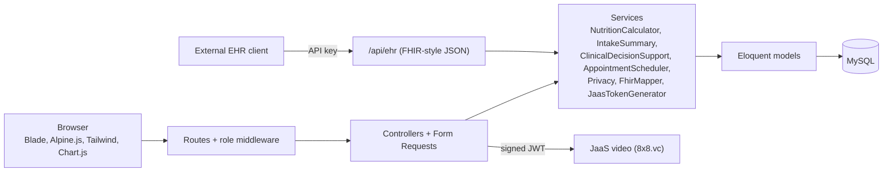
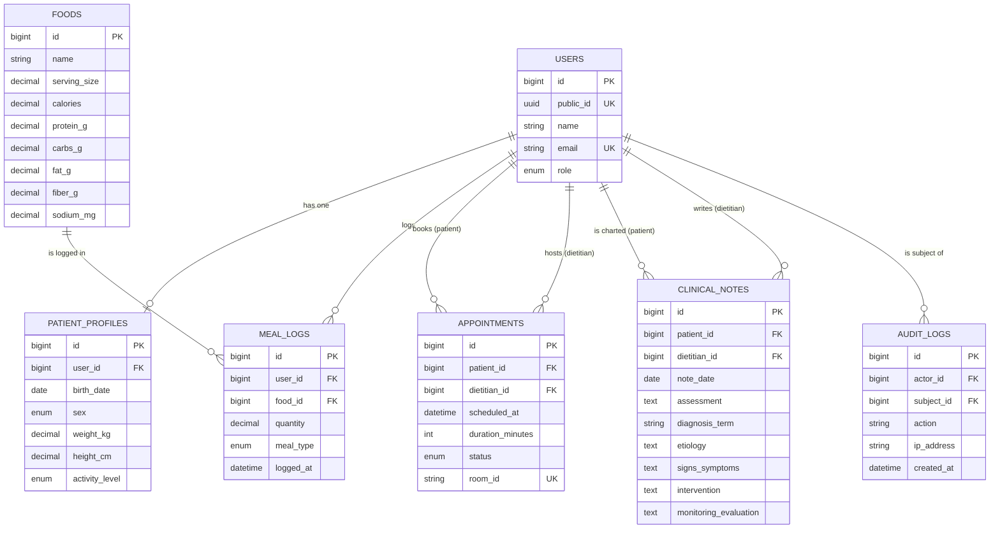

# TeleNutrition

A tele-nutrition and digital health platform. Patients log meals and see daily nutrition targets, dietitians review intake with decision-support flags and write ADIME chart notes, and both meet by secure video.

All demo data (patients, meals, notes) is fictional. This is a school project and does not replace advice from a licensed health professional.

## Features

**Patients**

- Health profile (age, sex, weight, height, activity level)
- Meal logging with a searchable food list and live nutrition preview
- Dashboard: energy ring, nutrient progress, 7-day logging streak and a weekly calorie chart
- Appointment booking with conflict checks, and secure video consultations

**Dietitians**

- Patient list with clinical decision-support (CDSS) flags
- Patient chart: intake versus targets, meals, and ADIME / PES chart notes
- Appointment management and video sessions
- De-identified CSV export

**Interoperability**

- Mock EHR API returning FHIR R4-style `Patient` and `Observation` resources, protected by an API key

## Tech stack

Laravel, PHP, MySQL, Blade, Alpine.js, Tailwind CSS, Chart.js, Jitsi as a Service (JaaS) for video, PHPUnit, SonarQube Cloud.

## Architecture



Business logic lives in `app/Services`. Controllers stay thin, and validation lives in Form Requests.

## Database



## How the project meets the evaluation criteria

| Criterion                            | Where to look                                                                                                                                                                                            |
| ------------------------------------ | -------------------------------------------------------------------------------------------------------------------------------------------------------------------------------------------------------- |
| System architecture and code quality | Layered design (routes, controllers, form requests, services, models); logic in `app/Services`; SonarQube Cloud analysis; automated tests in `tests/`                                                    |
| Domain accuracy and informatics      | `NutritionCalculator` (Mifflin-St Jeor BMR, activity factors, macro split, fiber and sodium targets); `ClinicalDecisionSupport` rules; nutrition diagnosis terms and PES / ADIME notes in `ClinicalNote` |
| Data privacy and interoperability    | Role-based access; pseudonymous `public_id`; de-identified export; audit log; FHIR-style mock EHR API with API key; foreign keys, unique keys and transactions                                           |
| UX and accessibility                 | Responsive Tailwind UI, charts with text alternatives, labelled forms, Lighthouse accessibility audits                                                                                                   |
| Tele-nutrition and end-to-end flow   | Appointment booking with conflict checks; JaaS video with signed JWT; `EndToEndFlowTest` covers register, meal logging, charting and video session                                                       |

## Run it locally

Requirements: PHP, Composer, Node.js, MySQL.

```bash
composer install
npm ci
cp .env.example .env
php artisan key:generate
```

Create an empty MySQL database named `tele_nutrition` and set `DB_*` in `.env`, then:

```bash
php artisan migrate --seed
php artisan db:seed --class=DemoSeeder
npm run build
php artisan serve
```

Open http://127.0.0.1:8000.

### Demo accounts (local only)

| Role      | Email                                                                                             | Password   |
| --------- | ------------------------------------------------------------------------------------------------- | ---------- |
| Dietitian | `dietitian@example.com`                                                                           | `password` |
| Patients  | `maria.demo@example.com`, `jun.demo@example.com`, `ana.demo@example.com`, `rico.demo@example.com` | `password` |

Run `php artisan db:seed --class=DemoSeeder` shortly before a demo so a video session is open ("Join now").

### Video (JaaS)

Create a JaaS account, add an API key, and set `JAAS_APP_ID`, `JAAS_KEY_ID` and either `JAAS_PRIVATE_KEY_PATH` (a file) or `JAAS_PRIVATE_KEY` (the key text, with line breaks written as `\n`). Never commit the private key.

### Mock EHR API

Set `EHR_API_KEY` in `.env`, then:

```
GET /api/ehr/Patient/{public_id}
GET /api/ehr/Observation?patient={public_id}&date=YYYY-MM-DD
Authorization: Bearer <EHR_API_KEY>
```

## Tests

```bash
php artisan test
```

Covers calculations, decision-support rules, booking rules, access control, privacy controls, the EHR API, database integrity, and an end-to-end flow.

## Known limitations

- The EHR API is a small FHIR-style subset, not full FHIR conformance. Nutrient codes are local, not a standard terminology.
- Decision-support thresholds (for example 75 percent of energy need) are program-defined and evaluate one day at a time. They are suggestions for a dietitian, not diagnoses.
- Exports use pseudonyms. This is pseudonymization, not full anonymization.
- Deleting a patient also deletes their chart notes. A real clinical system would retain records for a required period.
- The BMR equation is intended for adults.

## References to cite and verify

- Mifflin MD et al. (1990). Predictive equation for resting energy expenditure.
- DOST-FNRI: Philippine Dietary Reference Intakes (PDRI) and Philippine Food Composition Tables.
- WHO sodium intake guideline (less than 2,000 mg per day).
- Academy of Nutrition and Dietetics: Nutrition Care Process and Terminology (NCPT).
- HL7 FHIR R4. LOINC codes 29463-7 (body weight) and 8302-2 (body height).
